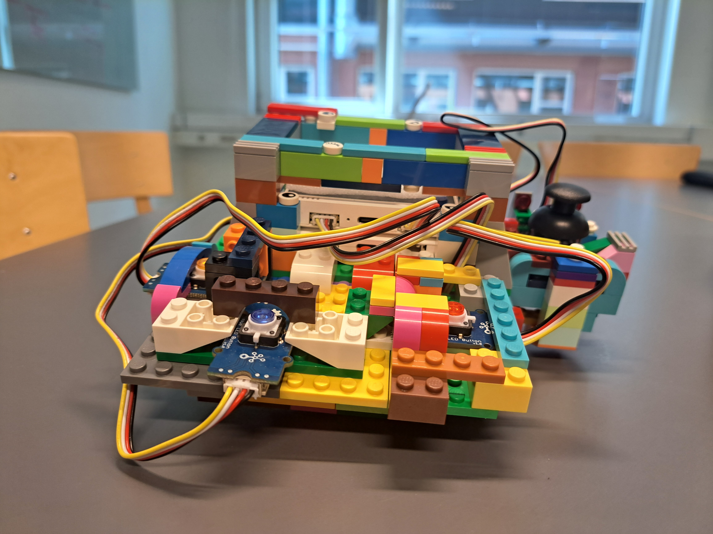
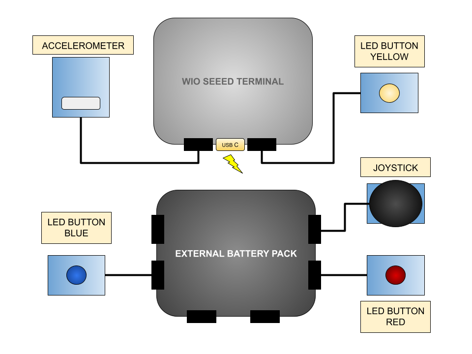
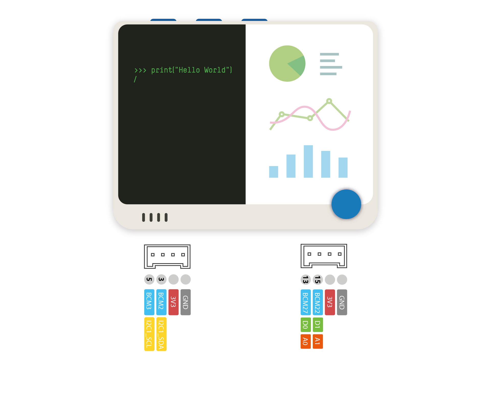
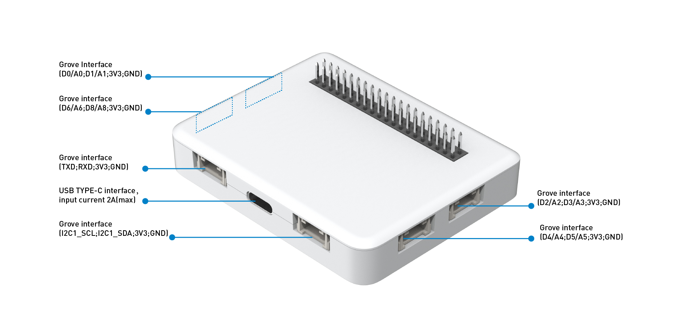
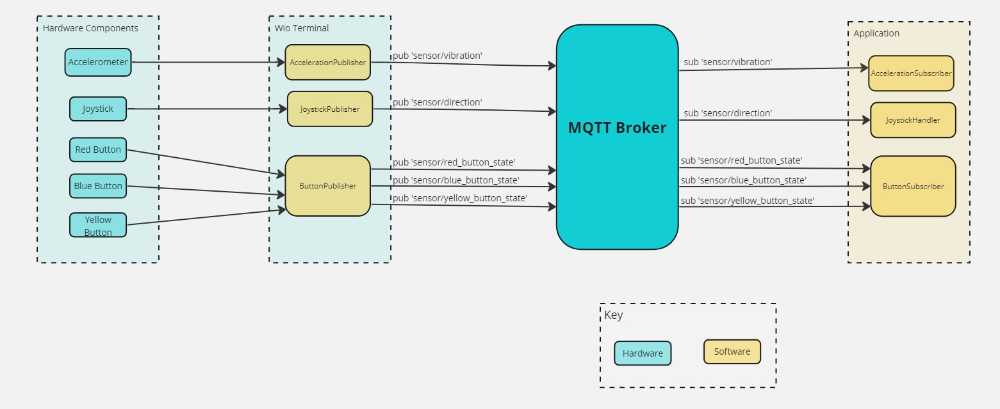

{width=60%}


## _What is Leveler?_

The primary purpose of Leveler Minigames is to provide an engaging entertainment system that also involves thought provoking tasks.

Leveler brings the benefits of exercising critical thinking, adaptation to rapidly changing environments, and time management.    

## _In-depth System Description_

Leveler minigames currently contains three primary minigames: _Bolt_, _Sequence_, and _Color Match_ (the latter of which has two variations, matching by either color or text). This system is composed of two primary surfaces: a graphical user interface and an embedded system controller. The computer surface is responsible for housing the code of the game, the graphical user interface, as well as the power delivery for the controller. The controller will read user input from three categories of Grove sensors that span: three LED buttons, a joystick, and an accelerometer. With a Wio Seeed terminal and battery extension, the sensors will provide various input forms required to play their respective minigame.

## _Getting Started with Leveler_
<details><summary><h3> Installation Prerequisites </h3></summary>

Leveler requires:
- Computer that can run Java JDK 20 or greater (install [Java](https://www.oracle.com/java/technologies/downloads/) from Oracle)
- Maven which can be installed following the instructions [here](https://www.baeldung.com/install-maven-on-windows-linux-mac)  
- Limited edition Leveler custom built controller

</details>

<details><summary><h3> Installation Guide </h3></summary> 

**Step 1:** _Obtain Game Files_
- Go to the [main project page](https://git.chalmers.se/courses/dit113/2024/group-14/minigames)
- Click on the "Code" drop down and either clone the repository (with SSH or HTTPS) or download the source code zip file

**Step 2:** _Configure Leveler Controller_
- Go to the [arduino-cli website](https://arduino.github.io/arduino-cli/0.35/installation/) and follow the instructions under "Use the install script". This will prepare the controller's arduino libraries.  
- In this file, a list of ardunio-cli commands will be found under "Install 'native' packages". Run the installs one after another in the bash/terminal:
    
```bash
    arduino-cli lib install "Seeed Arduino rpcWiFi@1.0.6"
    arduino-cli lib install "PubSubClient@2.8"
    arduino-cli lib install "Seeed Arduino RTC@2.0.0"
    arduino-cli lib install "Grove-3-Axis-Digital-Accelerometer-2g-to-16g-LIS3DHTR"
    arduino-cli lib install "Seeed Arduino rpcUnified"
    arduino-cli lib install "Accelerometer_MMA7660"
```

**Step 3:** _Build and Compile the System_ 
- Open your command prompt (or terminal on mac)
- Navigate to the directory (folder) where you cloned/downloaded the game files (don't forget to extract if it's the zip)
- Type the following commands one after the next in the command line:
     - mvn clean
     - mvn install
- These commands will create a folder named "target" among the game files where you can find a jar executable

**Step 4:** _Run the Game_
- Click on the Leveler-1.0-SNAPSHOT-shaded.jar to run the game
- Enjoy Leveler :D


**_ALTERNATIVE INSTALLATION AND RUNNING METHOD (without jar)_**

>_Given the system is having difficulties creating stable jar files, the steps above work but may result in bugs within areas such as the leaderboard and gameover screen._

>_The instructions below will circumvent this current issue, but will require extra steps._


_Step 1_: install an integrated development environment (IDE) of your choice ([Intellij Idea](https://www.jetbrains.com/idea/), [Visual Studio Code](https://code.visualstudio.com/) (recommended), [Eclipse](https://eclipseide.org/))

_Step 2_: follow the same steps as the "Obtain Game Files" for retrieving the Leveler files mentioned in the default installation guide.

_Step 3_: follow the same steps as the "Configure Leveler Controller" for setting up the controller libraries.

_Step 4_: next, go back to the IDE and click on the file named setup-build-env.sh

_Step 5_: navigate to the location where the game files are and open them in the IDE.

_Step 6:_ next, run the Launch.java file in the IDE

_Step 7:_ enjoy Leveler! :D

</details>


## _Hardware and Software Information_

<details><summary><h3> Controller Details </h3></summary>

Below is an image of the state-of-the-art Leveler controller:

{width=40%}

The following is a schematic layout of the controller sensors and their connections once built into the controller:

{width=40%}

Below is the WIO SEEED Terminal layout schematic courtesy of https://wiki.seeedstudio.com/Wio-Terminal-Getting-Started/

{width=60%}

The following is a schematic of the External Battery Chassis courtesy of https://wiki.seeedstudio.com/Wio-Terminal-Battery-Chassis/

{width=75%}
</details>

<details><summary><h3> System Architecure </h3></summary>

The two-tier system is facilitated via an MQTT broker publish/subscribe 'bridge' which is demonstrated in the diagram below:

{width=85%}

</details>

### → The Hardware used for this project include:
- Grove sensors (see specific sensor details in [wiki](https://git.chalmers.se/courses/dit113/2024/group-14/minigames/-/wikis/home/System-Sensor-List))
- WIO SEEED terminal
- Battery extension unit
- Wire connections
- Brick assembly system (lego bricks)

### → The Software used for this project include:
- Java JDK
- JavaFX & Scene Builder
- C++ (for Arduino)
- Maven
- Intellij Idea, VSCode, and Aruino IDEs
- GitLab remote repository system (for git, file organization, and pipeline)
- Git version control system

## _Project Developers and Contributions_

- **Rohma Wajid Rasul**
    > _Contributed by co-developing the Bolt and Color Match minigames, added the arduino cli configuration to the pipeline for the hardware build process, rewrote all the arduino code into a single program split into different files (classes), contributed to the wiki (requirements, issues and the architectural diagram), and code reviews._
- **Zhaoyu Wang (Jerome)**
    > _Contributed by co-developing Color Match minigame, creating game menu, tutorial, code reviews, and co-building the Leveler controller._ 
- **Karl Byland**
    > _Contributed by co-developing Sequence Game minigame, developing the leaderboard, helping with the ci pipeline, bug fixing in the color match mini-game, writing the wiki retrospective, and code reviews._
- **Filipe Rosa**
    > _Contributed by co-developing Bolt game and CI pipeline, co-building Leveler controller and researching arduino, maven, and code reviews._
- **David zum Felde**
    > _Contributed by co-developing Sequence Game minigame, developing game over screen, helping with project wiki, writing project README, co-building Leveler controller, create controller layout diagram, edit demo video, animated Leveler logo, and code reviews._      
## _Product Demo Video_

Feel free to checkout the official demo of the Leveler minigame product, complete with both tiers of the system.  

**→**  [Leveler Product Demo Video](https://youtu.be/CiNcn1dWq7g)